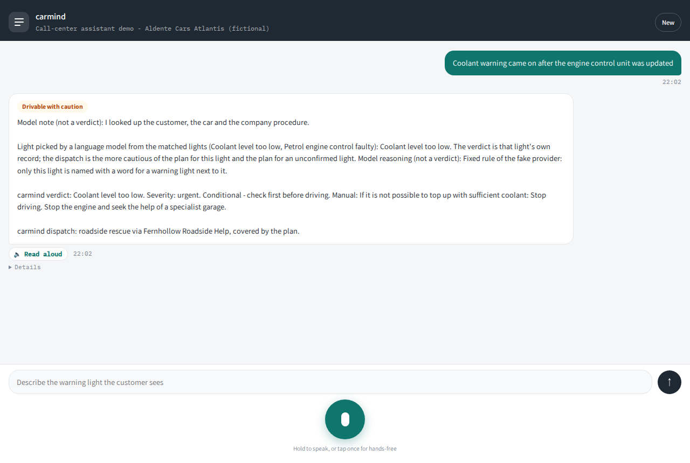

# carmind

Warning-light lookup for roadside-assistance calls: a caller describes a dashboard light, and carmind returns a sourced verdict (meaning, what to tell the driver, drive or do not drive) with the manual and page it came from (warning-light knowledge is shared per make and powertrain).



## How it answers

A language model talks to carmind through four MCP tools, but every verdict and dispatch line is written by code from the tool results; the model's own text appears only as a labelled note. The model's choices come from closed lists that code enforces, and the car-history facts it infers can only make the verdict more cautious. A fake provider runs the demo and the tests with no API key.

## Architecture

```
 browser UI  --POST /api/agent-->  app (FastAPI, :7600)
                                    |  agent loop: model provider
                                    |  (fake | anthropic | openai)
                                    |
                                    +--MCP (streamable HTTP)-->  mcp (:7601, internal)
                                                                  get_customer
                                                                  assess_warning_light
                                                                  get_company_procedure
                                                                  plan_dispatch
                                                                    |
                                    knowledge/ (JSON, read-only) <--+
                                    manual facts, customers, policy, dispatch model
```

The reply is assembled in this order: the model note (if it passes the guard), the inferred context and the light choice (when luna gave them), then `carmind verdict: ...` and `carmind dispatch: ...`, both built from tool fields. The app itself calls each tool the reply needs that has no good result yet (the model failed, skipped it or got an error), and repeats that call in-process if it fails; if the MCP service fails or the deadline passes, the tools still without a result run in-process.

All customers, plates, places and companies are invented (the fictional town of Fernhollow; the phone numbers are in the 555-0100 to 555-0199 range set aside for fiction).

## Quickstart

Requirements: Docker with Compose.

```
git clone <this repository> carmind
cd carmind
docker compose up -d --build
```

Open http://127.0.0.1:7600. The menu button at the start of the header opens the drawer. The first demo caller is already picked; you can pick another (it fills the caller number), and add a plate number if the caller has more than one car. Pick an example there, or type the warning light in the box at the bottom, then press the send button or Enter. Each answer shows carmind's reply with a verdict badge, and Details shows the dispatch, the model's labelled note and choices, the tool calls and the provider. Where the browser offers on-device speech recognition, you can also hold the microphone button and speak: the text goes into the box and is sent only when you send it.

Open it on the computer that runs it: dictation and browser saves need a secure page, and the compose file publishes the service on this computer only. The page is laid out for phone-sized screens too (try your browser's device emulation).

## Run the image

The release image carries the service, the knowledge base and the schema:

```
docker pull ghcr.io/roeybar/carmind:1.0.0
docker run --rm -p 127.0.0.1:7600:7600 ghcr.io/roeybar/carmind:1.0.0
```

Open http://127.0.0.1:7600. Run on its own, the app calls the tools in-process. It uses the fake provider unless `CARMIND_PROVIDER` is set; a real provider also needs its key and model id, and without them the reply carries the deterministic verdict and an `error`. The constrained choices are off unless `LUNA_MODE=on` (the compose demo turns them on). Pass these with `-e` or with `--env-file .env`. The same image runs the MCP server, with the command compose uses for the mcp service; its tools are then at http://127.0.0.1:7601/mcp:

```
docker run --rm -p 127.0.0.1:7601:7601 ghcr.io/roeybar/carmind:1.0.0 python -m app.mcp_server
```

## Configuration

Optional. Copy `.env.example` to `.env` and set:

| Variable | Meaning |
|---|---|
| `CARMIND_PROVIDER` | `fake` (default), `anthropic` or `openai` |
| `ANTHROPIC_API_KEY`, `CARMIND_ANTHROPIC_MODEL` | key and model id when the provider is `anthropic` |
| `OPENAI_API_KEY`, `CARMIND_OPENAI_MODEL` | key and model id when the provider is `openai` |
| `LUNA_MODE` | `on` (the demo default) lets a language model infer listed car-history context flags (they can only tighten) and pick one of several matched drivable lights, from closed lists; `off` makes no model call |
| `LUNA_TOTAL_BUDGET_S` | seconds both luna calls of a request may take together (default 10, at most 30); after that there is no answer |

Keys are read from the environment only and never logged.

## Tests

All checks run in containers through one wrapper:

```
bash serve/bin/serve-stack test        # the service suite
bash serve/bin/serve-stack lint        # ruff
bash serve/bin/serve-stack e2e         # HTTP and browser end-to-end (Playwright)
bash serve/bin/serve-stack stress      # concurrent requests, fake provider only
bash serve/bin/serve-stack down
```

GitHub Actions runs the build, lint and test suites on every push.

## Status

Prototype, not deployed. It covers the Skoda petrol Kamiq, Scala, Octavia, Fabia and Karoq from one owner's manual, the Kamiq's: a comparison with the Octavia manual found the warning-light meanings shared across the make's petrol models (knowledge/manual-sharing-finding.md); any other recognised vehicle gets an escalation, and a request without an identified vehicle gets a request for the plate number. The customer data, company policy and dispatch model are synthetic.

## License

PolyForm-Noncommercial-1.0.0 (the PolyForm Noncommercial License 1.0.0). See [LICENSE](LICENSE).

The bundled Assistant, Noto Sans Arabic and IBM Plex Mono fonts are under the SIL Open Font License 1.1 (serve/app/static/fonts/).
